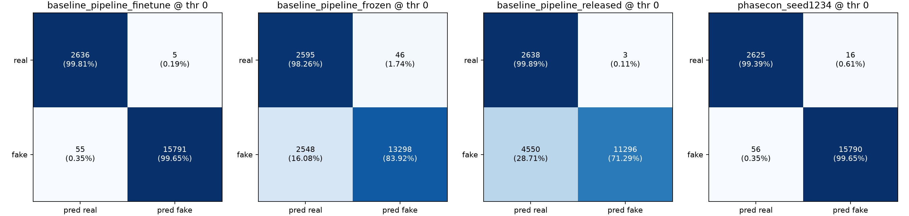
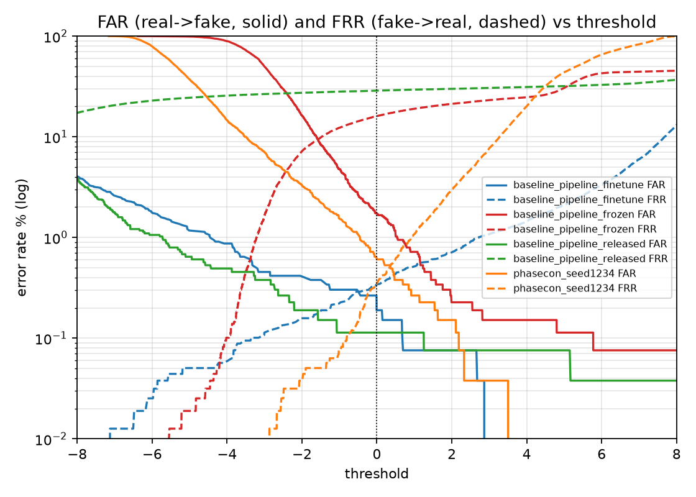
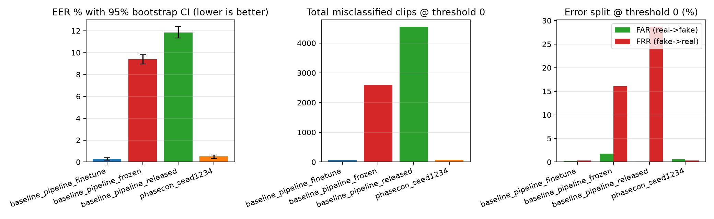
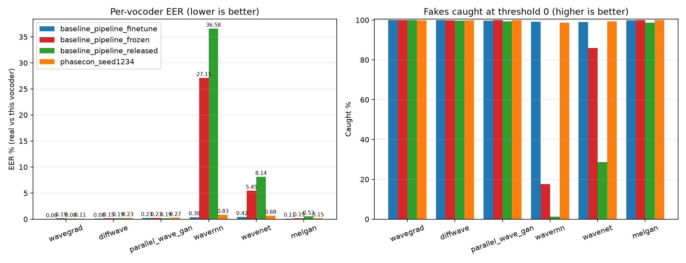
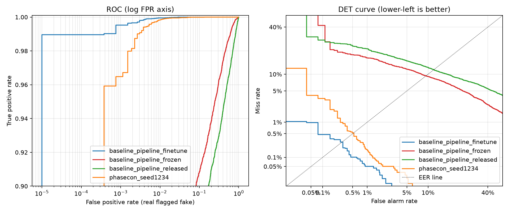
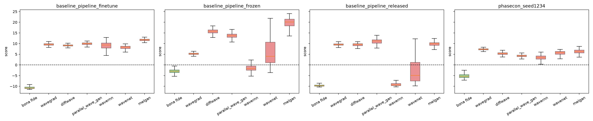
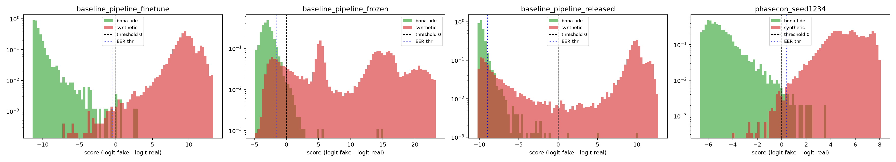

# Evaluation comparison

Runs: baseline_pipeline_finetune, baseline_pipeline_frozen, baseline_pipeline_released, phasecon_seed1234. Reference for paired tests: `baseline_pipeline_finetune`. Bootstrap resamples: 500.

## Overall metrics (test split)

| Metric | baseline_pipeline_finetune | baseline_pipeline_frozen | baseline_pipeline_released | phasecon_seed1234 |
|---|---|---|---|---|
| Clips | 18487.000 | 18487.000 | 18487.000 | 18487.000 |
| Real | 2641.000 | 2641.000 | 2641.000 | 2641.000 |
| Fake | 15846.000 | 15846.000 | 15846.000 | 15846.000 |
| EER % | 0.290 | 9.397 | 11.852 | 0.524 |
| EER 95% CI low | 0.161 | 8.971 | 11.327 | 0.341 |
| EER 95% CI high | 0.379 | 9.795 | 12.372 | 0.650 |
| AUC | 1.000 | 0.966 | 0.944 | 1.000 |
| EER thr | -0.530 | -1.575 | -8.994 | 0.361 |
| TPR@1%FPR | 99.950 | 82.261 | 76.612 | 99.830 |
| TPR@0.1%FPR | 99.527 | 58.627 | 70.447 | 96.479 |
| Acc@0 % | 99.675 | 85.969 | 75.372 | 99.611 |
| Precision@0 % | 99.968 | 99.655 | 99.973 | 99.899 |
| Recall@0 % | 99.653 | 83.920 | 71.286 | 99.647 |
| F1@0 % | 99.810 | 91.113 | 83.227 | 99.773 |
| FAR@0 % (real->fake) | 0.189 | 1.742 | 0.114 | 0.606 |
| FRR@0 % (fake->real) | 0.347 | 16.080 | 28.714 | 0.353 |
| Acc@EERthr % | 99.708 | 90.599 | 88.148 | 99.475 |
| Errors@0 | 60.000 | 2594.000 | 4553.000 | 72.000 |
| FP@0 | 5.000 | 46.000 | 3.000 | 16.000 |
| FN@0 | 55.000 | 2548.000 | 4550.000 | 56.000 |

## Per-vocoder EER % (real vs that vocoder)

| Vocoder | baseline_pipeline_finetune | baseline_pipeline_frozen | baseline_pipeline_released | phasecon_seed1234 |
|---|---|---|---|---|
| diffwave | 0.076 | 0.151 | 0.189 | 0.227 |
| melgan | 0.114 | 0.189 | 0.530 | 0.151 |
| parallel_wave_gan | 0.227 | 0.227 | 0.189 | 0.265 |
| wavegrad | 0.000 | 0.189 | 0.076 | 0.114 |
| wavenet | 0.417 | 5.452 | 8.141 | 0.682 |
| wavernn | 0.379 | 27.111 | 36.577 | 0.833 |

## Per-vocoder fakes caught % at threshold 0

| Vocoder | baseline_pipeline_finetune | baseline_pipeline_frozen | baseline_pipeline_released | phasecon_seed1234 |
|---|---|---|---|---|
| diffwave | 99.962 | 99.924 | 99.697 | 99.924 |
| melgan | 99.886 | 100.000 | 98.637 | 100.000 |
| parallel_wave_gan | 99.773 | 100.000 | 99.432 | 99.962 |
| wavegrad | 100.000 | 99.962 | 100.000 | 99.924 |
| wavenet | 99.091 | 86.028 | 28.663 | 99.318 |
| wavernn | 99.205 | 17.607 | 1.287 | 98.750 |

## Paired comparison vs reference

McNemar tests whether the two models' accuracy at threshold 0 differs on the same clips; the dEER interval comes from paired bootstrap (if it excludes 0 the EER difference is unlikely to be sampling noise).

| Reference | Run | Paired clips | Ref right, run wrong | Run right, ref wrong | McNemar p (acc@0) | dEER pp (run-ref) | dEER 95% CI low | dEER 95% CI high |
|---|---|---|---|---|---|---|---|---|
| baseline_pipeline_finetune | baseline_pipeline_frozen | 129409 | 44062 | 280 | 0 | 49.71 | 49.32 | 50.13 |
| baseline_pipeline_finetune | baseline_pipeline_released | 129409 | 54248 | 241 | 0 | 49.71 | 49.32 | 50.14 |
| baseline_pipeline_finetune | phasecon_seed1234 | 129409 | 31786 | 314 | 0 | 49.71 | 49.36 | 50.09 |

## Figures

